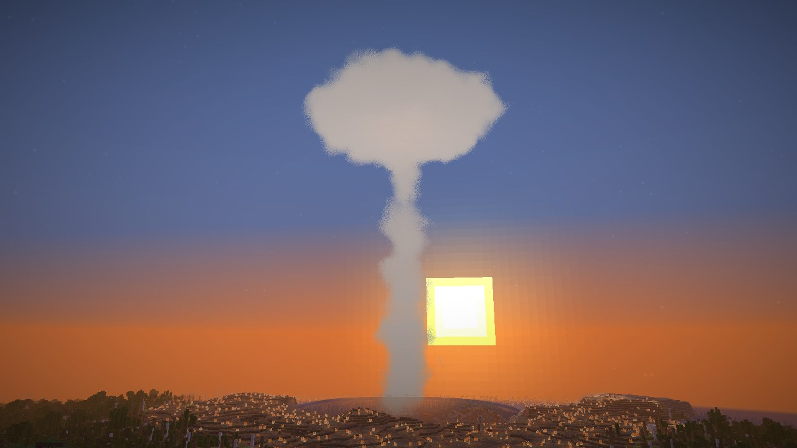
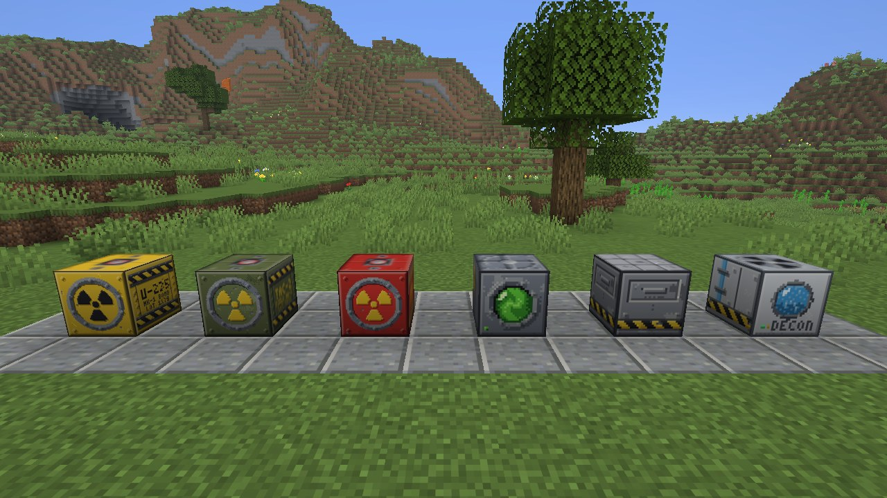
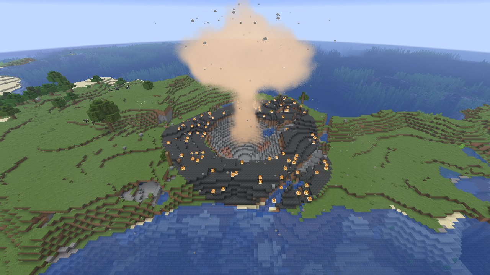
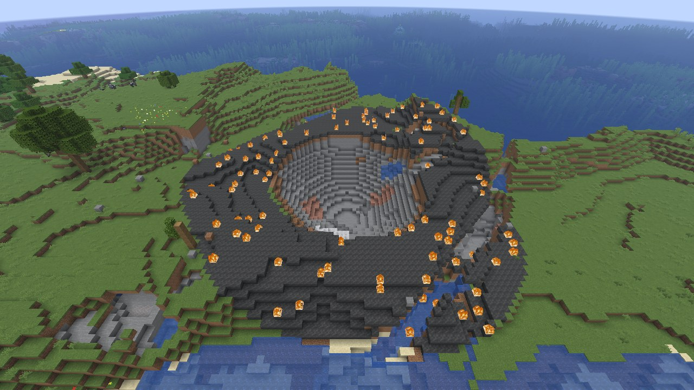
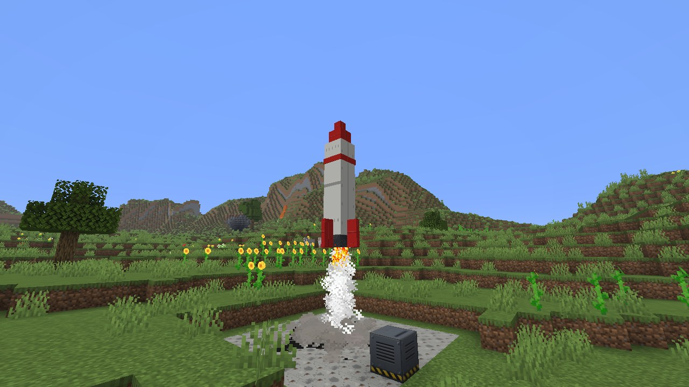
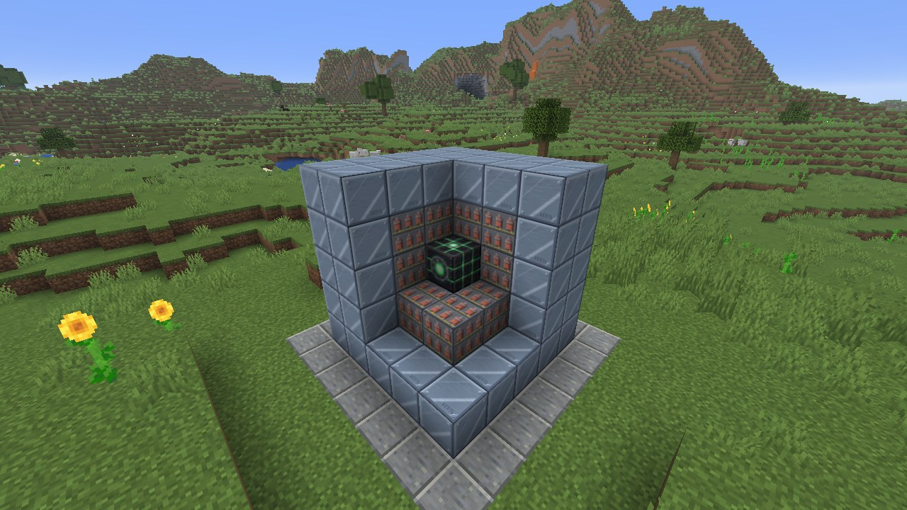
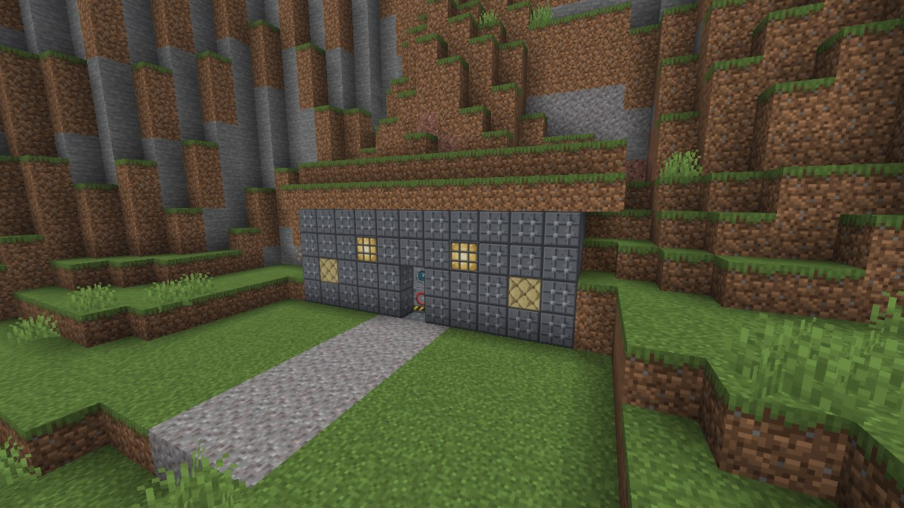
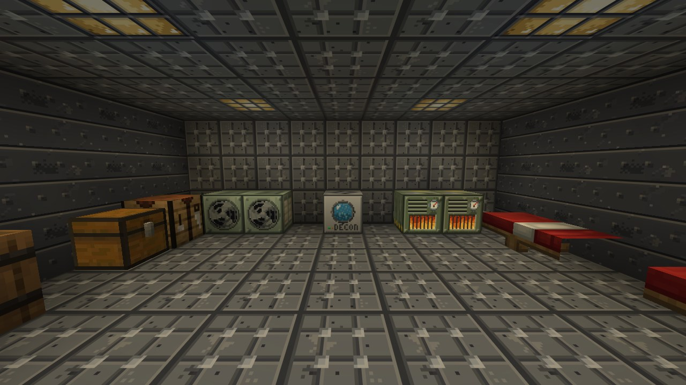

# Big Nukes

A mod for [Horizon](https://github.com/horizon-rust/horizon) (Minecraft: Java Edition 26.3 in Rust). Bombs whose
shockwave rolls across the land, from a demolition charge to the Sunbreaker, which leaves a hole through the bedrock.
Mine uranium, enrich it, assemble the bombs, set them off by fuse, keypad, remote, missile or bomber, then fight the
radiation they leave or wait it out in a bunker.

> **One file:** install `big_nukes_native` on the launcher's Mods page and press Build. Its textures, models, sounds,
> text and recipes come inside it, so no separate content mod is needed.

## How to play

1. **Mine uranium.** Uranium ore lies below y=16, in stone and deepslate. An iron pickaxe or better gets raw uranium.
2. **Enrich it** in a centrifuge: raw uranium in the upper slot, fuel in the lower one.
3. **Assemble** the parts and the bombs on the assembly table: put a recipe's parts anywhere in its grid and press
   Assemble.
4. **Place** a bomb and right-click it with a detonator.
5. **Set it off**, and be far away: at least 400 blocks from an atomic bomb.

The **Big Nukes Guide** tells all of this in the game, chapter by chapter, with the recipes. Craft it from a book and a
raw uranium, or type `/bignukes guide`.

## Bombs

| Bomb | Radius | What it leaves |
|---|---|---|
| Demolition Charge | 16 | A crater, no radiation. It takes only a fuse detonator |
| Tactical Warhead | 50 | A crater, scorched ground and weak radiation that fades away |
| Atomic Bomb | 250 | A wasteland and a zone that stays radioactive |
| Sunbreaker | 600 to 1000 | Built where it stands. At 1000 it breaks through the bedrock and leaves a hole into the void |

A blast is seen from far beyond your render distance: a flash, a fireball rising into a mushroom cloud, and a ring of
dust rolling out at 50 blocks a second. The sound and the shaking come with the front, not with the flash. Behind the
front, the core is a crater; further out the plants, the glass and the water are gone and the ground is ash, with
fires; at the edge the glass breaks and the leaves fall. Creatures die in the core and are hurt less the further out
they are.

A blast's wave sets off every bomb it reaches. Chunks that aren't loaded when the wave passes are finished when they
load.

## Detonators

- **Fuse:** light the bomb with flint and steel and run. You have 4 seconds.
- **Keypad:** right-click the bomb with an empty hand. The first code you type, 3 to 8 digits, becomes its code. The
  right code sets it off in 5 seconds; three wrong ones lock the keypad for 30 seconds.
- **Receiver:** right-click the bomb with a remote to link them. The remote's tooltip names its bomb. Aim at the sky and
  right-click, from any distance, even from another dimension. Aimed at a block, the remote does nothing.

## Missile and bomber

**Missile.** Build a shaft: a launch pad at the bottom, at least 6 blocks of air over it, and a silo hatch on top with
open sky above. Put a missile and a tactical warhead or an atomic bomb in the pad's two slots. Place a launch console
within 8 blocks of the pad and right-click it. Type the target's X and Z and a code of 3 to 8 digits; Tab moves between
the fields, Enter launches. The code of the console's first launch becomes its code, and three wrong codes lock it for
30 seconds. The target is 100 to 4096 blocks away.

After a 5 second countdown the hatch opens and the missile climbs out in smoke. A camera follows it for the one who
launched; the Camera button turns it off. The missile goes off on its target, even far from any player.

**Bomber.** Place a strike beacon and right-click it with a tactical warhead or an atomic bomb. 30 seconds later a
bomber flies over, 120 blocks up, and drops the bomb on the beacon. Break the beacon before the drop to get the bomb
back.

## The Sunbreaker

The largest bomb is built in the world:

1. Place the **Sunbreaker Core**.
2. Close it in 26 **Implosion Shells**: the 3×3×3 cube round it.
3. Wrap those in 98 **Neutron Reflectors**: the surface of the 5×5×5 cube.

A whole shell gives radius 600, and each reflector adds its share, up to 1000. Without a whole shell it doesn't go off.
It is read when it goes off, so a broken part makes it weaker.

Right-click any of its blocks to reach the core: it takes any detonator, and with an empty hand it tells you its shell,
its reflector and its radius. Its fuse burns 15 seconds, with an alarm over the last 5. You won't outrun radius 1000 on
foot. Missiles and bombers can't carry it. Sneak to place a block against it.

## Radiation

The tactical warhead and the larger bombs leave a radioactive zone, a fifth wider than the blast. Inside it your dose
builds up:

| Dose | What happens |
|---|---|
| 100 rad | Weak and hungry |
| 300 rad | Sick |
| 600 rad | Very sick |
| 1000 rad | Death |

Out of the zone the dose falls by half a rad a second. Mobs in the zone are hurt too, and the air there is a greenish
fog. A tactical warhead's zone halves every 10 minutes and goes; a larger one halves every 40 minutes and never quite
goes.

- **Geiger Counter:** hold it to hear the radiation and read the background and your dose.
- **Hazmat suit:** the full suit keeps 95% out (helmet 25%, jacket 30%, pants 25%, boots 15%). It wears down while you
  are in a zone.
- **Anti-Rad:** drink it to take 300 rad off your dose.
- **Iodine Tablets:** eat one before you go in. For 5 minutes half the radiation is kept out, with the suit or without
  it. Another tablet makes it 5 minutes again.
- **Shelter:** where the open sky can't be seen, under ground or under a roof, the background is halved.

### The decontaminator

Put any furnace fuel in it. It burns it 4 times as fast as a furnace, and while it burns its circle grows a block every
2 seconds, up to 48. Inside, the background falls to nothing (it comes back over 8 blocks past the edge), and the ash on
open ground turns back to grass. What it cleaned stays clean without fuel and after the block is broken, but a new blast
brings the radiation back. Hoppers bring fuel.

## The bunker

A wall the wave can't hold cracks first, then breaks, and a cracked wall holds half. Under the crater's floor the wave
touches nothing, and a roof that holds keeps the blast off whoever is under it.

| Wall | Holds |
|---|---|
| Reinforced Concrete | A demolition charge anywhere, a tactical warhead at the edge of its crater |
| Armored Concrete | An atomic bomb away from the center of its crater |
| Multilayer wall | A Sunbreaker away from its center |

A **multilayer wall** is four blocks in a row out from the blast: concrete (reinforced or armored), a **Lead Shield**,
a **Blast Damper** and concrete again. A roof laid in that order from the top down counts too. A lead shield or a damper
alone is weak. TNT and creepers can't break any of these walls.

- **Hermetic Door:** holds the blast like armored concrete. It opens by hand or with redstone.
- **Fuel Generator:** burns furnace fuel twice as long as a furnace and powers the air filters and lamps within 16
  blocks.
- **Air Filter:** a powered filter goes round its room every 5 seconds. Shut by walls and closed doors, with up to 4096
  blocks of air and no gap to the sky or to the open air outside, the room is sealed and lets in only 5% of the
  radiation. An open door unseals it.
- **Bunker Lamp:** shines while a burning generator is within 16 blocks.
- **Ration:** filling and eaten fast, for the long wait.

## Recipes

**On a crafting table:**

- **Centrifuge:** a furnace, five iron ingots, glass and two redstone.
- **Assembly Table:** a crafting table ringed with eight iron ingots.
- **Big Nukes Guide:** a book and a raw uranium.
- **Fuse Detonator:** an iron ingot between two gunpowder, string above and below.
- **Keypad Detonator:** three stone buttons, five iron ingots and redstone.
- **Receiver Detonator:** a redstone torch, five iron ingots and redstone.
- **Remote Detonator:** an ender pearl, four iron ingots, a stone button and redstone.
- **Geiger Counter:** six iron ingots, glass, redstone and a raw uranium.
- **Hazmat suit:** yellow wool in the shape of armour; the helmet has a glass pane.
- **Anti-Rad:** a glass bottle, a golden carrot and redstone.
- **Iodine Tablets** (2): three dried kelp and sugar.
- **Launch Pad:** four blocks of iron, four obsidian and a block of redstone.
- **Silo Hatch:** eight iron trapdoors round redstone.
- **Launch Console:** five iron ingots, a glass pane, two redstone and a comparator.

**On the assembly table**, the parts anywhere in the grid:

| Makes | From |
|---|---|
| Nuclear Charge | 1 enriched uranium, 4 TNT |
| Bomb Casing | 4 blocks of iron, 4 redstone |
| Demolition Charge | 4 TNT, 4 iron ingots, 1 redstone |
| Tactical Warhead | 1 nuclear charge, 1 bomb casing, 6 iron ingots, 1 redstone |
| Atomic Bomb | 4 nuclear charges, 4 bomb casings, 1 block of redstone |
| Missile | 2 bomb casings, 3 blocks of iron, 4 blaze powder |
| Strike Beacon | 4 iron ingots, 4 redstone, 1 compass |
| Sunbreaker Core | 4 weapons-grade uranium, 4 nuclear charges, 1 block of diamond |
| Implosion Shell | 4 TNT, 2 blocks of iron, 2 redstone |
| Neutron Reflector (4) | 4 blocks of iron, 1 enriched uranium |
| Decontaminator | 4 blocks of iron, 2 water buckets, 1 sponge, 2 redstone |
| Reinforced Concrete (4) | 4 gray concrete, 4 iron ingots, 1 gravel |
| Armored Concrete (4) | 4 reinforced concrete, 4 blocks of iron, 1 netherite ingot |
| Lead Shield (4) | 4 iron ingots, 4 clay balls, 1 enriched uranium |
| Blast Damper (4) | 4 white wool, 2 slimeballs, 2 iron ingots |
| Hermetic Door | 6 armored concrete, 2 blocks of iron, 1 redstone |
| Fuel Generator | 4 blocks of iron, 1 furnace, 2 redstone, 2 copper ingots |
| Air Filter | 4 iron ingots, 2 coal, 2 paper, 1 enriched uranium |
| Bunker Lamp (4) | 1 block of copper, 2 glowstone, 1 redstone |
| Ration (4) | 2 raw beef, 2 potatoes, 1 iron ingot |

**In the centrifuge:** one raw uranium makes one enriched uranium in 20 seconds; four enriched uranium make one
weapons-grade uranium in 60 seconds. Hoppers feed it and empty it, as they do a furnace.

## On a server

Operators have two commands:

| Command | What it does |
|---|---|
| `/bignukes blast <radius> [x y z]` | Sets off a blast of radius 8 to 1024, where you stand or at x y z |
| `/bignukes maxpower` | Shows the largest blast this world allows |
| `/bignukes maxpower <16\|50\|250\|1000\|1024>` | Sets it |

No blast over the limit goes off, the command's own included, and a bomb, a missile or a bomber says why. The limit
starts at 1024, which allows everything. Each world keeps it in `horizon-big-nukes/waves.json`, in the world's folder.
Anyone can type `/bignukes guide`.

## Good to know

- Every player needs the mod. It runs with your account's permissions, as every native mod does.
- It is pinned to Horizon Nightly 2026-11-05 (66f3981).
- It is made for single player and play with friends: anyone can set off a bomb anywhere.
- The ground past your render distance is changed when its chunks load; the cloud and the ring are seen from any
  distance.
- A lit fuse burns only while its chunk is loaded.
- The crater stops under the Nether's roof. Blasts work in the Overworld, the Nether and the End, not in other
  dimensions.
- Only an opening to the open sky unseals a filter's room: a glass window in a wall doesn't, but a skylight does, and so
  does a gap filled with something that lets air through (a fence, a pane, iron bars, a torch, leaves). A room that
  reaches a chunk not loaded isn't sealed.
- A remote sets off a Sunbreaker whose chunk isn't loaded with the radius its core last read. One never read refuses:
  come near it once.
- A blast hurts as an ordinary explosion.

The text is in English and Russian, following the game's language. All the art and sounds are original, and no
Minecraft code or assets are included.

## License

MIT
